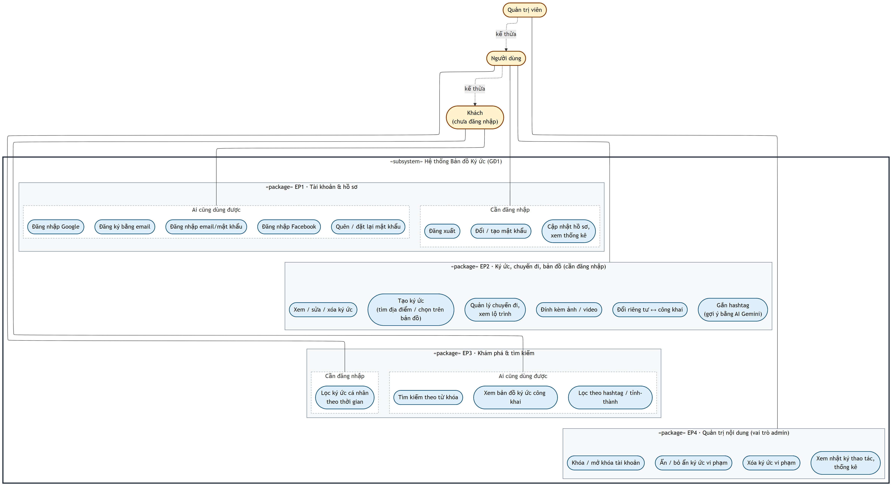

[← Danh mục sơ đồ](README.md)

# Sơ đồ use case

## Hình 1: Sơ đồ use case tổng quát (GĐ1)

*3 tác nhân (Khách, Người dùng, Quản trị viên) và 22 use case chia theo 4 epic. Trong EP1 và EP3, use case được tách thành nhóm "Ai cũng dùng được" (nối với Khách) và "Cần đăng nhập" (nối với Người dùng). EP2 nối với Người dùng, EP4 nối với Quản trị viên. Quan hệ tổng quát hóa (nét đứt "kế thừa"): Người dùng có mọi quyền của Khách; Quản trị viên có mọi quyền của Người dùng.*

Nguồn hình: [src/hinh-1.mmd](src/hinh-1.mmd). Tham chiếu: SRS §2.4, §5.2.
