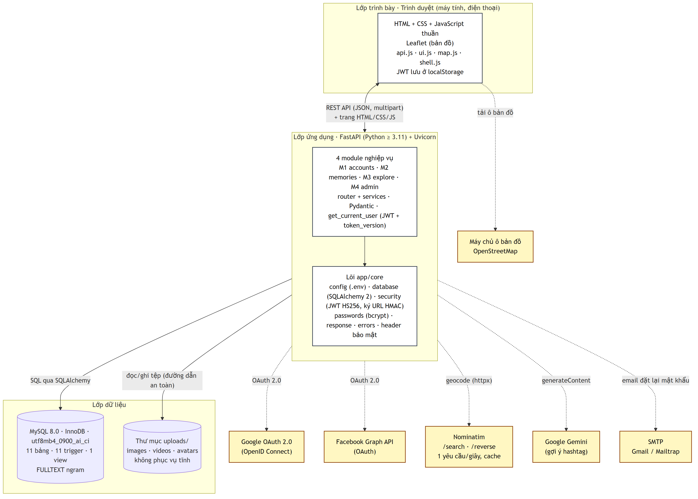
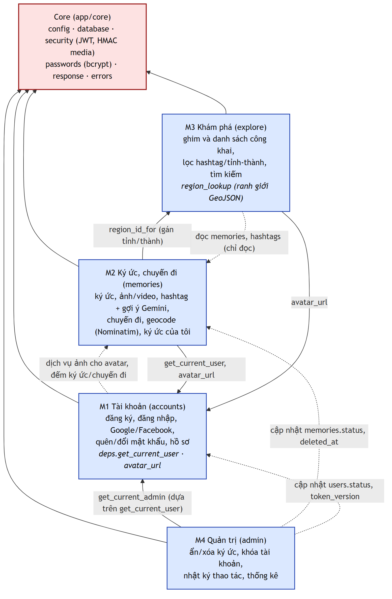

[← Danh mục sơ đồ](README.md)

# Kiến trúc và phụ thuộc module

## Hình 2: Sơ đồ kiến trúc tổng thể (3 lớp)

*Lớp trình bày (trình duyệt: HTML/CSS/JS thuần, Leaflet) ⇄ Lớp ứng dụng (FastAPI: 4 module nghiệp vụ dùng chung lõi `app/core`) ⇄ Lớp dữ liệu (MySQL 8.0 với 11 bảng, 11 trigger, 1 view; thư mục `uploads/` không phục vụ tĩnh). Dịch vụ ngoài: ô bản đồ OpenStreetMap (trình duyệt tải trực tiếp), Google OAuth, Facebook Graph API, Nominatim, Google Gemini, SMTP.*

Nguồn hình: [src/hinh-2.mmd](src/hinh-2.mmd). Tham chiếu: SRS §2.5, §6.3.

## Hình 3: Sơ đồ phụ thuộc module (Core, M1–M4)

*Cả 4 module dùng lõi `app/core`. Nét liền: gọi hàm của module khác (`get_current_user`, `avatar_url` của M1; `region_id_for` của M3). Nét đứt: đọc hoặc cập nhật dữ liệu thuộc module khác (M3 đọc ký ức, hashtag; M4 cập nhật trạng thái ký ức và tài khoản; M1 dùng dịch vụ ảnh của M2 cho ảnh đại diện).*

Nguồn hình: [src/hinh-3.mmd](src/hinh-3.mmd). Tham chiếu: SRS §3.1.
