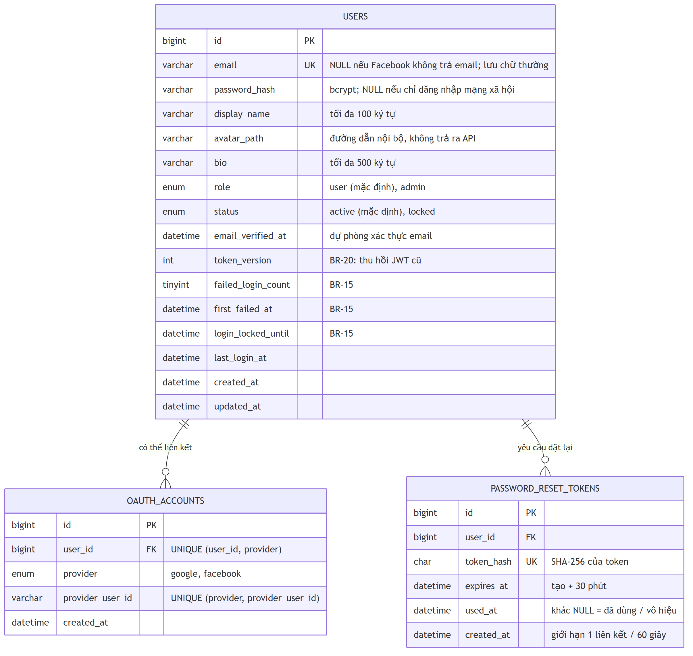
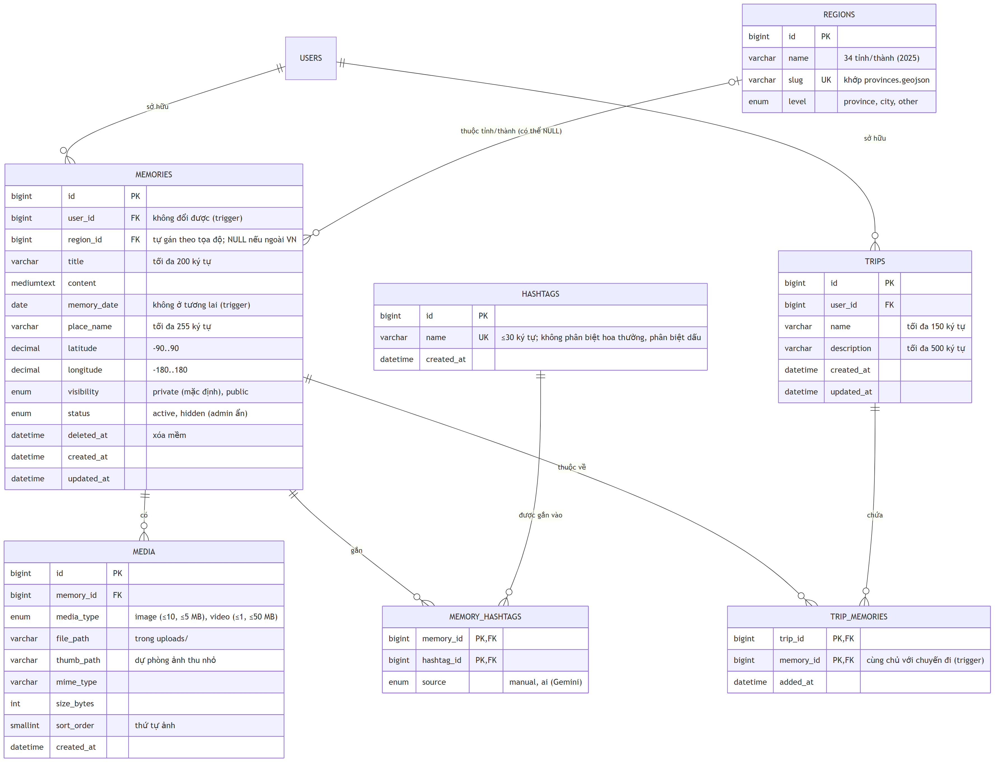
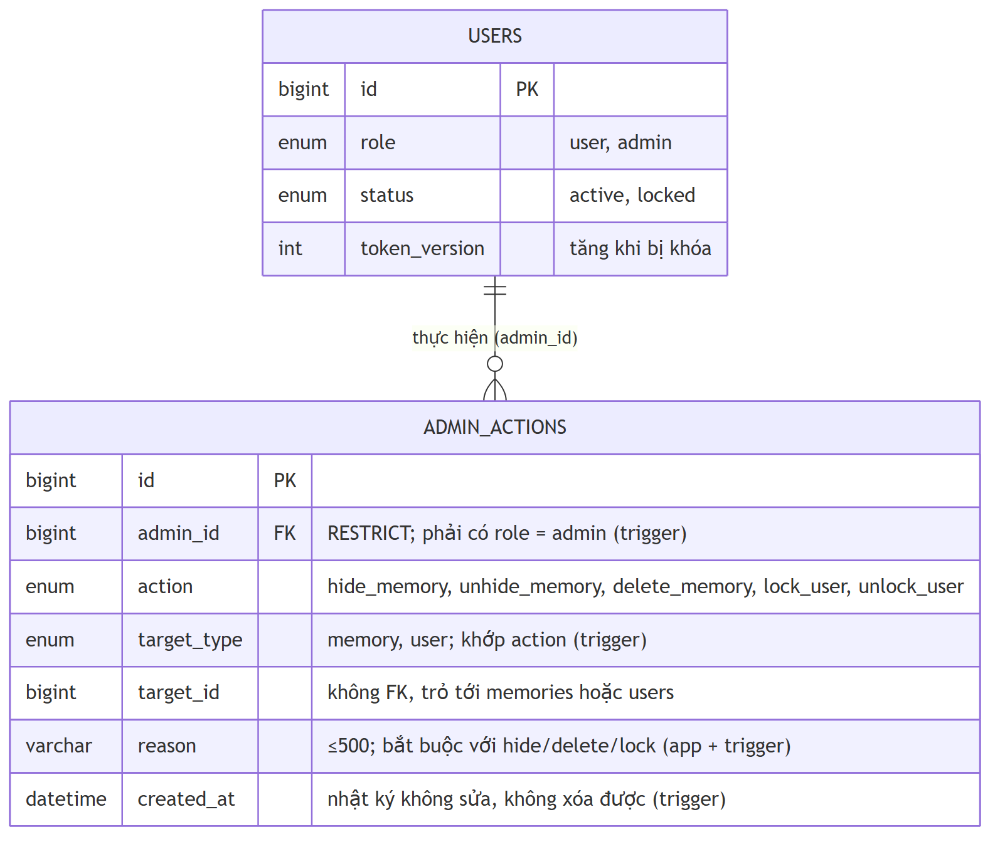

[← Danh mục sơ đồ](README.md)

# Sơ đồ thực thể liên kết (ERD)

Ba hình khớp [schema.sql](../schema.sql) bản cuối. Mô tả đầy đủ từng cột và trigger ở [SRS Phụ lục C](../srs/phu-luc-c-tu-dien-du-lieu.md).

## Hình 4: ERD Module Tài khoản

*USERS (tài khoản, hồ sơ, vai trò, trạng thái, `token_version`, bộ đếm sai mật khẩu) liên kết với OAUTH_ACCOUNTS (Google/Facebook, mỗi nhà cung cấp tối đa một liên kết mỗi tài khoản) và PASSWORD_RESET_TOKENS (chỉ lưu SHA-256 của token, hạn 30 phút).*

Nguồn hình: [src/hinh-4.mmd](src/hinh-4.mmd).

## Hình 5: ERD Module Ký ức, Chuyến đi, Bản đồ

*MEMORIES là trung tâm, liên kết USERS (chủ sở hữu), REGIONS (34 tỉnh/thành, có thể NULL), MEDIA (ảnh/video), MEMORY_HASHTAGS–HASHTAGS (gắn thẻ, ghi nguồn manual/ai) và TRIP_MEMORIES–TRIPS (chuyến đi, nhiều–nhiều).*

Nguồn hình: [src/hinh-5.mmd](src/hinh-5.mmd).

## Hình 6: ERD Module Quản trị

*ADMIN_ACTIONS ghi nhật ký mọi thao tác ẩn/bỏ ẩn/xóa ký ức, khóa/mở khóa tài khoản. Trigger bắt buộc người thao tác là admin, có lý do với ẩn/xóa/khóa, và cấm sửa/xóa nhật ký.*

Nguồn hình: [src/hinh-6.mmd](src/hinh-6.mmd).
