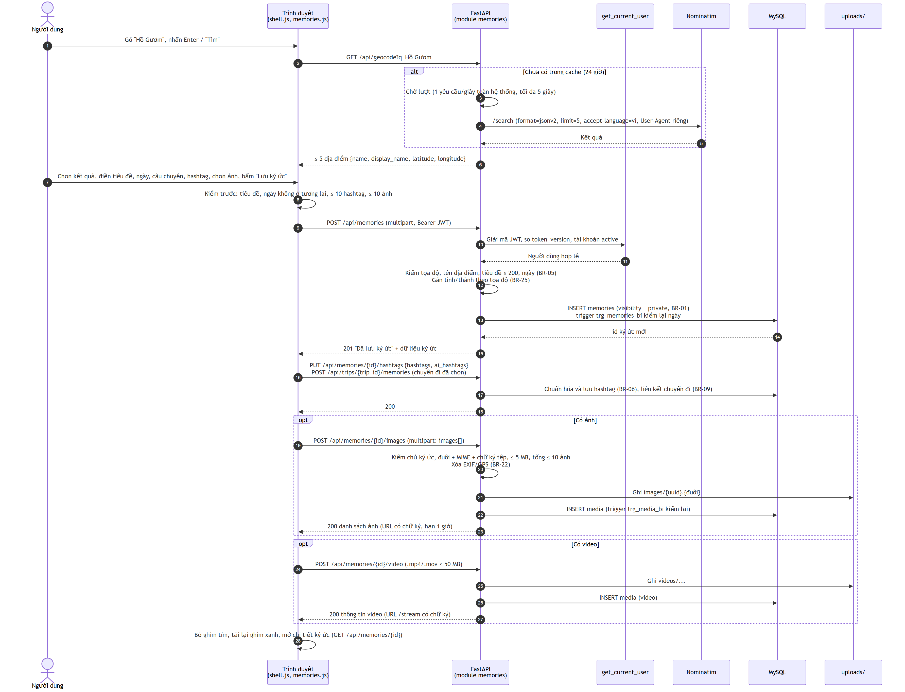
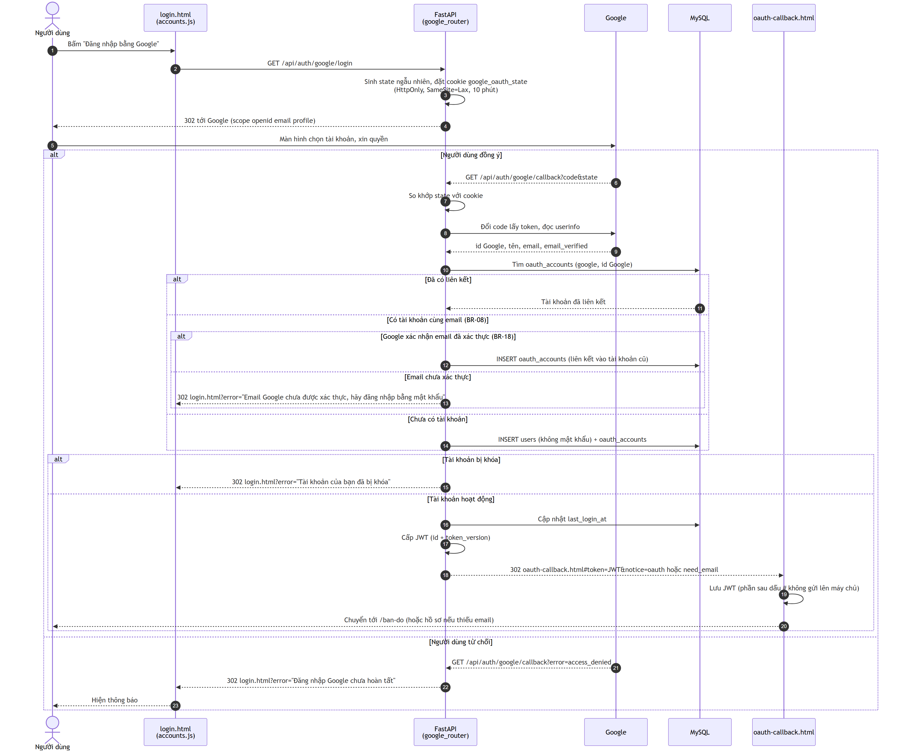
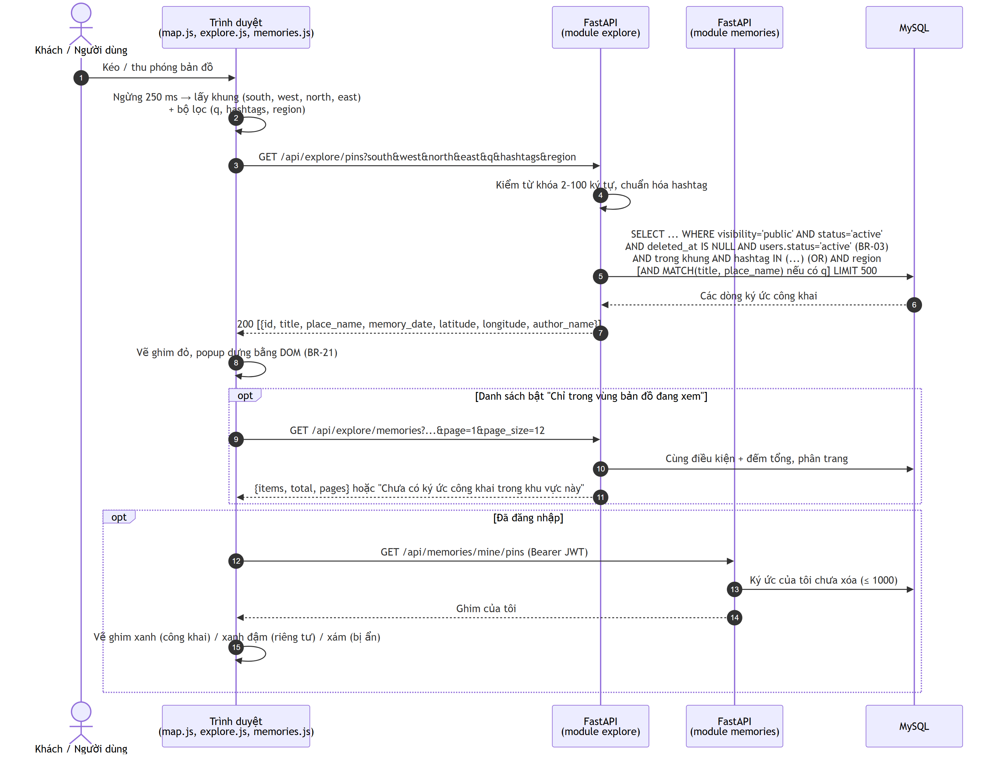

[← Danh mục sơ đồ](README.md)

# Luồng xử lý

## Hình 7: Luồng xử lý tạo ký ức kèm ảnh

*Tìm địa điểm qua `GET /api/geocode` (Nominatim, 1 yêu cầu/giây, cache 24 giờ) → `POST /api/memories` (kiểm JWT, BR-05, gán tỉnh/thành, mặc định riêng tư) → lưu hashtag và chuyến đi đã chọn → tải ảnh `POST /api/memories/{id}/images` (kiểm định dạng 3 lớp, xóa EXIF/GPS) và video `POST /api/memories/{id}/video` → mở chi tiết ký ức.*

Bước 16–18 (lưu hashtag, chuyến đi) là hành vi bắt buộc theo FR-2.7, FR-2.9; bản demo hiện chưa thực hiện bước này (SRS §11.3, vấn đề số 1).

Nguồn hình: [src/hinh-7.mmd](src/hinh-7.mmd). Tham chiếu: US-MEM-001, US-MEM-003, US-MEM-004, US-MEM-010.

## Hình 8: Luồng xử lý đăng nhập bằng Google

*OAuth 2.0 authorization code chạy ở máy chủ: sinh `state` lưu cookie HttpOnly → Google → callback so khớp `state`, đổi code lấy hồ sơ → tìm tài khoản theo id Google đã liên kết, theo email trùng (chỉ khi Google xác nhận email đã xác thực), hoặc tạo mới → chặn tài khoản bị khóa → cấp JWT qua `oauth-callback.html#token=…`. Nhánh từ chối quay về trang đăng nhập với "Đăng nhập Google chưa hoàn tất".*

Nguồn hình: [src/hinh-8.mmd](src/hinh-8.mmd). Tham chiếu: US-ACC-003, BR-08, BR-18.

## Hình 9: Luồng xử lý xem ghim công khai trong vùng nhìn bản đồ

*Ngừng kéo bản đồ 250 ms → `GET /api/explore/pins` với khung nhìn và bộ lọc → truy vấn đủ 4 điều kiện BR-03, tối đa 500 ghim → vẽ ghim đỏ. Danh sách bên trái gọi `GET /api/explore/memories` (12 mục/trang). Người đã đăng nhập thêm ghim của mình từ `GET /api/memories/mine/pins`.*

Nguồn hình: [src/hinh-9.mmd](src/hinh-9.mmd). Tham chiếu: US-EXP-001, US-EXP-002, US-EXP-003, US-EXP-004.
