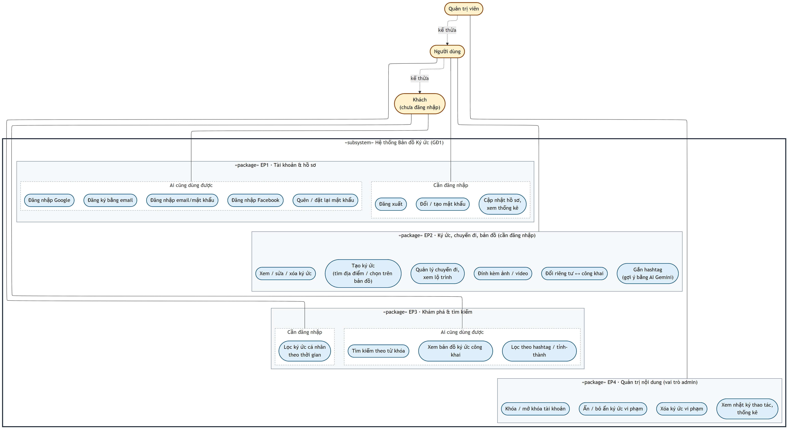

[← Mục lục SRS](README.md)

# 2. Mô tả tổng quan

## 2.1 Bối cảnh sản phẩm

Giới trẻ thích đi phượt và chia sẻ trải nghiệm, còn khách du lịch cần tìm cảnh đẹp để đi. Chưa có nơi gộp cả hai nhu cầu: vừa là nhật ký cá nhân, vừa là bản đồ gợi ý địa điểm do cộng đồng đóng góp. Bản đồ Ký ức là sản phẩm độc lập; giao diện chính là một bản đồ toàn màn hình, các chức năng nằm trong thanh bên và ngăn kéo trượt lên.

## 2.2 Chức năng chính

| Nhóm | Chức năng | Ai dùng |
|---|---|---|
| Trang mở đầu (`/`) | Giới thiệu sản phẩm, 3 ký ức công khai mới nhất, số ký ức công khai và số tỉnh/thành có ký ức | Mọi người |
| Bản đồ (`/ban-do`) | Ghim đỏ của cộng đồng, ghim xanh của mình, bật/tắt từng lớp, về vị trí hiện tại, tìm địa điểm | Mọi người (ghim xanh cần đăng nhập) |
| Panel Khám phá | Lọc ký ức công khai theo tỉnh/thành, hashtag, từ khóa, vùng bản đồ; danh sách có "Tải thêm" | Mọi người |
| Panel Của tôi | Danh sách ký ức của mình, lọc theo năm, tháng, khoảng ngày, chế độ, hashtag; tạo ghim mới | Người dùng |
| Panel Chuyến đi | Tạo, sửa, xóa chuyến đi; thêm/bỏ ký ức; xem lộ trình trên bản đồ | Người dùng |
| Form ký ức | Chọn vị trí, tiêu đề, ngày, câu chuyện, hashtag (có gợi ý AI), ảnh, video, chế độ, chuyến đi | Người dùng |
| Tài khoản | Đăng ký, đăng nhập (email, Google, Facebook), quên/đặt lại mật khẩu, hồ sơ, đổi mật khẩu, đăng xuất | Khách, người dùng |
| Quản trị (`/admin/`) | Thống kê; ký ức công khai (tìm, ẩn, bỏ ẩn, xóa); tài khoản (tìm, khóa, mở khóa); nhật ký thao tác | Quản trị viên |

## 2.3 Đối tượng và vai trò người dùng

| **Vai trò** | **Mô tả** | **Quyền chính** |
|---|---|---|
| Khách (chưa đăng nhập) | Người truy cập bất kỳ, thường là khách du lịch tìm cảnh đẹp | Xem trang mở đầu, bản đồ và chi tiết ký ức công khai, lọc, tìm kiếm. Khi thử ghim ký ức thì được mời đăng nhập. |
| Người dùng (`role = 'user'`) | Đã đăng ký/đăng nhập, thường là bạn trẻ thích đi phượt | Toàn bộ quyền của khách, cộng với ký ức, chuyến đi, hashtag, hồ sơ của chính mình. |
| Quản trị viên (`role = 'admin'`) | Thành viên vận hành hệ thống | Toàn bộ quyền của người dùng, cộng với trang quản trị: ẩn/bỏ ẩn/xóa ký ức công khai, khóa/mở khóa tài khoản, xem nhật ký và thống kê. |

Tài khoản quản trị không đăng ký qua giao diện. Tạo bằng `scripts/seed_demo.py` (có sẵn `admin@example.com`) hoặc đổi `users.role = 'admin'` trực tiếp trong CSDL.

## 2.4 Sơ đồ use case tổng quát

*Hình 1: Sơ đồ use case tổng quát (GĐ1). Chú thích đầy đủ ở [so-do/01-use-case.md](../so-do/01-use-case.md).*

## 2.5 Môi trường vận hành và công nghệ

| Thành phần | Công nghệ thực tế |
|---|---|
| Trình duyệt | Chrome, Edge, Firefox, Safari bản hiện hành; máy tính và điện thoại (responsive, từ 360 px) |
| Giao diện | HTML, CSS, JavaScript thuần (không framework), tách file theo module; bản đồ **Leaflet** với nền **OpenStreetMap** |
| Máy chủ ứng dụng | Python ≥ 3.11 (đã chạy trên 3.14), **FastAPI** ≥ 0.115, Uvicorn, Pydantic 2, pydantic-settings |
| Truy cập dữ liệu | **SQLAlchemy 2** (ORM), PyMySQL, cryptography |
| Cơ sở dữ liệu | **MySQL 8.0**, InnoDB, `utf8mb4_0900_ai_ci` (không phân biệt dấu và hoa thường); FULLTEXT parser `ngram` |
| Bảo mật | bcrypt (băm mật khẩu), PyJWT (HS256), HMAC-SHA256 (ký URL media), email-validator |
| Gọi dịch vụ ngoài | httpx (Google, Facebook, Gemini), smtplib (email) |
| Lưu tệp | Thư mục cục bộ `uploads/` trên máy chủ (`images/`, `videos/`, `avatars/`), không phục vụ tĩnh |
| Kiểm thử | pytest (238 test, chạy trên SQLite trong bộ nhớ); kiểm thử tích hợp bằng Python + Playwright (Edge) trên MySQL thật |

Kiến trúc 3 lớp: trình duyệt ⇄ FastAPI (4 module M1 đến M4 dùng chung lõi `app/core`) ⇄ MySQL + thư mục `uploads/`. FastAPI vừa cung cấp REST API dưới `/api`, vừa phục vụ các trang HTML/CSS/JS. Xem Hình 2 và Hình 3 ở [so-do/02-kien-truc.md](../so-do/02-kien-truc.md).

## 2.6 Cấu hình

Cấu hình đọc từ file `.env` ở thư mục gốc (mẫu `.env.example`). Thiếu khóa của một dịch vụ tùy chọn thì ứng dụng vẫn chạy, chỉ tắt chức năng tương ứng.

| Nhóm | Biến | Bắt buộc | Khi để trống |
|---|---|---|---|
| Môi trường | `APP_ENV` (mặc định `dev`) | Có | — |
| MySQL | `DB_HOST`, `DB_PORT`, `DB_USER`, `DB_PASSWORD`, `DB_NAME` | Có | Không chạy được |
| Phiên đăng nhập | `JWT_SECRET`, `ACCESS_TOKEN_MINUTES` (mặc định 1440) | Có | Dùng giá trị mặc định không an toàn |
| Ký URL media | `MEDIA_SECRET` | Có | Dùng giá trị mặc định không an toàn |
| Liên kết trong email | `APP_BASE_URL` | Không | `http://127.0.0.1:8000` |
| Google OAuth | `GOOGLE_CLIENT_ID`, `GOOGLE_CLIENT_SECRET`, `GOOGLE_REDIRECT_URI` | Không | Nút Google bị làm mờ |
| Facebook OAuth | `FACEBOOK_APP_ID`, `FACEBOOK_APP_SECRET`, `FACEBOOK_REDIRECT_URI` | Không | Nút Facebook bị làm mờ |
| Email | `SMTP_HOST`, `SMTP_PORT`, `SMTP_USERNAME`, `SMTP_PASSWORD`, `SMTP_FROM`, `SMTP_SSL` | Không | Ở `APP_ENV=dev`: trang quên mật khẩu hiện thẳng liên kết đặt lại để thử. Môi trường khác: không gửi được, chỉ ghi log. |
| AI | `GEMINI_API_KEY` | Không | Gợi ý hashtag theo từ khóa trong tiêu đề/nội dung/địa điểm, không gọi AI |

Một số tham số cố định trong code (`app/core/config.py`): thời hạn URL media 3600 giây, User-Agent gửi Nominatim `BanDoKyUc/0.1 (do-an-sinh-vien)`, thời gian chờ Nominatim 5 giây, Gemini 8 giây, Google/Facebook 5 giây.

## 2.7 Ràng buộc

- Nhóm 4 người làm theo Agile/Scrum, mỗi người phụ trách một module; mỗi task một nhánh Git, gộp vào `master` qua pull request.
- Giao diện, thông báo lỗi và email bằng tiếng Việt.
- Chỉ dùng dịch vụ ngoài miễn phí hoặc có hạn mức miễn phí: OpenStreetMap, Nominatim, Google/Facebook OAuth, Gemini, Gmail SMTP (App Password) hoặc Mailtrap khi kiểm thử.
- Tuân thủ chính sách sử dụng Nominatim: tối đa 1 yêu cầu/giây cho toàn hệ thống, có User-Agent riêng, có cache, không gọi khi người dùng đang gõ (BR-19).
- Không đưa khóa bí mật (`.env`) và tệp tải lên (`uploads/`) lên kho mã nguồn.

## 2.8 Giả định và phụ thuộc

- Người dùng có kết nối Internet (nền bản đồ và Nominatim cần Internet).
- Máy chủ có MySQL 8.0. Trigger và FULLTEXT ngram chỉ có trên MySQL; test tự động chạy SQLite nên không kiểm được hai phần này (kiểm thử tích hợp bù lại).
- Đăng nhập mạng xã hội cần nhóm đăng ký ứng dụng với Google Cloud Console và Meta for Developers, khai báo đúng địa chỉ callback.
- Ranh giới tỉnh/thành lấy từ bộ dữ liệu `ThangLeQuoc/vietnamese-provinces-database` (giấy phép MIT), đã rút gọn còn khoảng 200 KB. Cập nhật khi có thay đổi địa giới bằng `scripts/tao_ranh_gioi_tinh.py`.
- Dịch vụ ngoài có thể chậm hoặc ngừng: hệ thống phải báo lỗi rõ ràng và có phương án dự phòng (chọn vị trí trên bản đồ thay cho tìm tên; gợi ý hashtag theo từ khóa thay cho AI).
